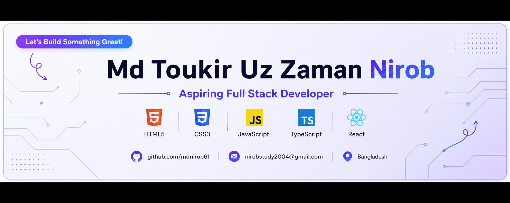

  

<h1 align="center">Hi 👋, I'm Md Toukir Uz Zaman Nirob</h1>

  

I'm a Computer Science & Engineering student passionate about **Full Stack Web Development**. I enjoy building modern, responsive, and user-friendly web applications while continuously improving my development skills.

- 🎓 CSE Student
- 💻 Full Stack Developer
- 🌱 Currently exploring **Next.js and Full Stack Development**
- ⚛️ Experienced with **React.js, Next.js, and TypeScript**
- 🔧 Working with **Node.js, Express.js, and MongoDB**
- 🚀 Building real-world web applications and projects
- 🧠 Improving my problem-solving and programming skills
- 📚 Always learning and exploring new technologies

---

## 🛠️ Technology Stack

### Languages

  

### Frontend Development

  

### Backend Development

  

### Tools & Technologies

  

---

## 📊 GitHub Statistics

  

---

## 🔥 GitHub Streak

  

---

## 💻 Most Used Languages

  

---

## 🚀 My Goals

- Strengthen my JavaScript and TypeScript skills
- Become proficient in **Next.js and React.js**
- Improve my backend development skills
- Master database management and API development
- Build scalable and real-world full-stack applications
- Improve problem-solving and software development skills
- Become a professional **Full Stack Developer**

---

## 📈 GitHub Contributions

  

---

### ⭐ Thanks for visiting my profile!

  <i>Keep learning. Keep building. Keep growing. 🚀</i>

